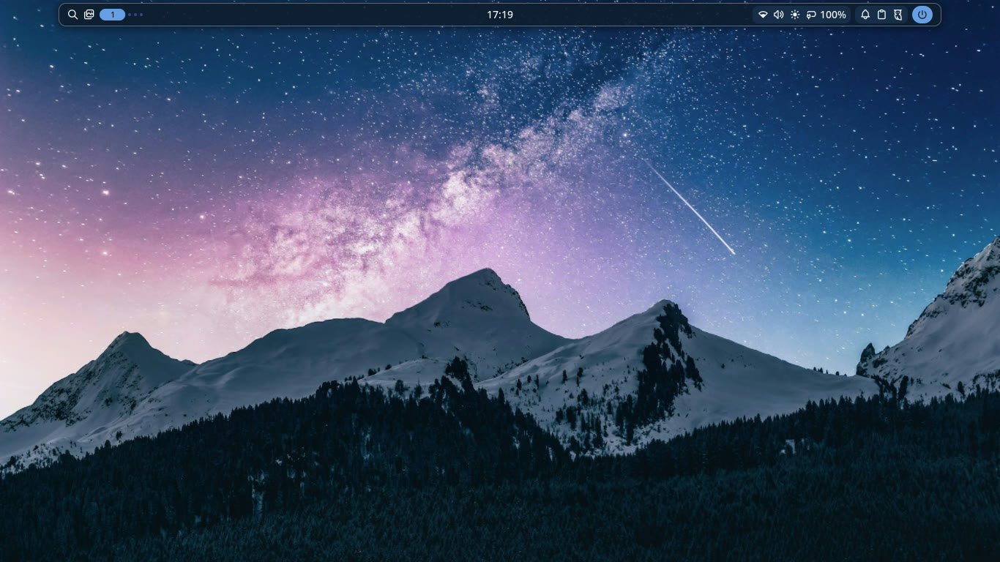
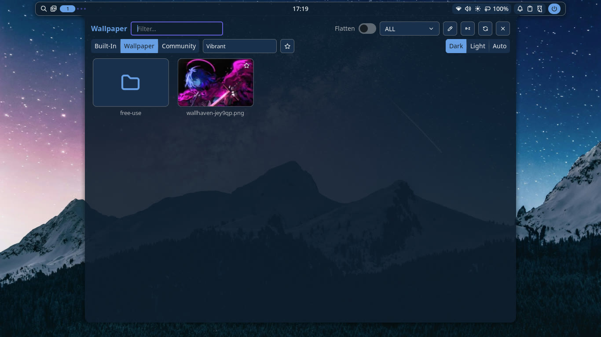
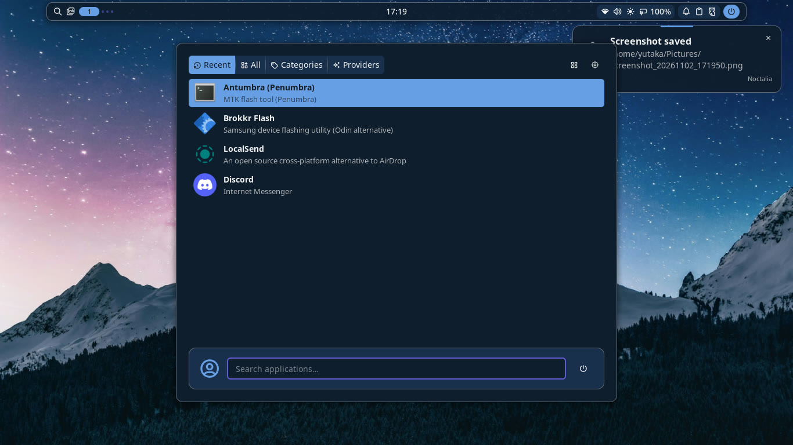
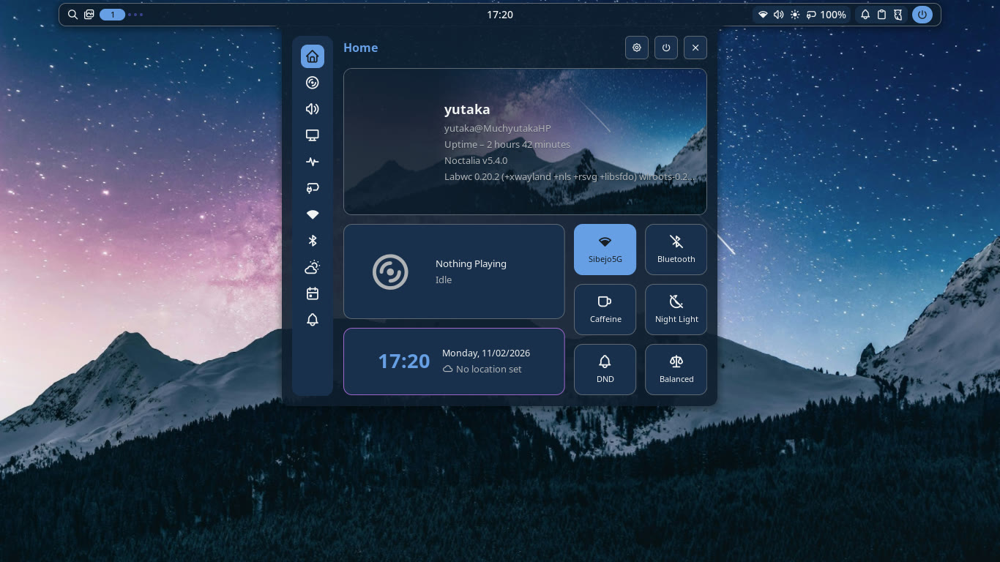
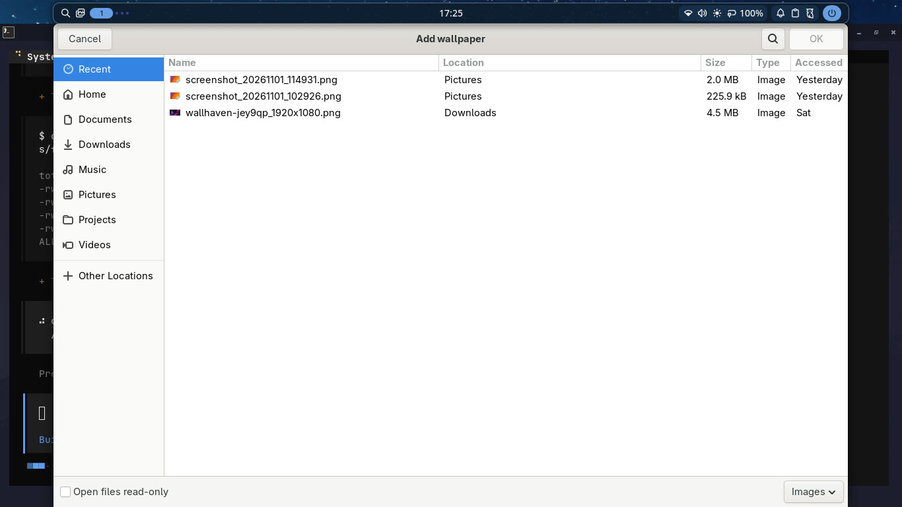

# arch-labwc-noctalia

> **Note:** I used AI to help in making the install script

A Wayland desktop for Arch Linux built on labwc and Noctalia v5, with Catppuccin foot and a palette taken from the current wallpaper.



| Wallpaper picker (`Super+w`) | Launcher (`Super+Space`) |
|---|---|
|  |  |

| Control centre (`Super+s`) | Add your own wallpaper (`Super+Alt+w`) |
|---|---|
|  |  |

## Features

- labwc with 4 workspaces, 10 px gaps, a thumbnail switcher, and keyboard resize
- Noctalia v5 bar, launcher, control centre, notifications, and a palette taken from the wallpaper
- foot with Catppuccin Mocha, JetBrains Mono Nerd Font, and 0.96 alpha
- hyfetch at login with a clean Arch logo
- Screenshots of a region, fullscreen, or a window, saved to `~/Pictures` and the clipboard
- Screen recording to `~/Videos/Recordings`, with the default audio output; `Super+Shift+r` starts and stops it
- A wallpaper picker, next/previous switching, and an "add your own" file chooser
- Nautilus with MTP and archive support
- Flatpak; add Flathub with `flatpak remote-add --if-not-exists flathub https://flathub.org/repo/flathub.flatpakrepo`
- Optional apps: Discord, Brave, LocalSend, Amberol, Antumbra/Penumbra, Brokkr Flash, and developer extras, each asked about during install

## Requirements

- Arch Linux, x86_64
- Wayland-capable GPU (Intel/AMD; NVIDIA untested)
- ~2 GB free disk

## Install

```bash
git clone https://github.com/Muchyutaka/arch-labwc-noctalia.git
cd arch-labwc-noctalia
./install.sh
```

The installer adds the base packages and copies the dotfiles, backing up anything it replaces. It asks separately whether to install each optional app (the default is no), downloads five free-use wallpapers, and asks once before enabling services.

| Flag | Effect |
|---|---|
| `--no-packages` | dotfiles + wallpapers only |
| `--no-system` | skip enabling services / display manager |
| `--no-wallpapers` | skip the wallpaper downloads |
| `--optional` | install every optional app without asking |
| `--no-optional` | skip all optional apps without asking |
| `--yes, -y` | assume yes for every prompt (optional apps included) |
| `--system -y` | non-interactive, everything |

After it finishes, log out and back in, then choose labwc at the `ly` prompt.

## Optional apps

Press `Enter` at any prompt to skip that app. None of them are required for the desktop or the keybinds.

| App | Installed as |
|---|---|
| Discord | `discord` (official repo) |
| Brave | `brave-bin` (AUR) |
| LocalSend | `localsend-bin` (AUR) |
| Amberol | `amberol` and `gst-libav` for extra codecs (official repo) |
| Antumbra / Penumbra | GitHub release, installed to `~/.local/bin/antumbra` with a `penumbra` symlink |
| Brokkr Flash | GitHub AppImage into `~/Applications/Brokkr.AppImage`, plus a `brokkr-flash` wrapper (`fuse2` is installed with it) |
| Developer extras | `android-tools`, `scrcpy`, `opencode` |

Non-interactive choices:

```bash
./install.sh --optional      # install all of the above
./install.sh --no-optional   # skip all of them
```

Install or update the two user-local tools later:

```bash
./scripts/install-antumbra.sh
./scripts/install-brokkr.sh
```

Antumbra and Brokkr talk to USB devices. If access is denied, add udev rules for your device; this repo does not install any.

## Keybinds

| Key | Action |
|---|---|
| `Super+Space` | Launcher |
| `Super+s` | Control centre |
| `Super+,` | Noctalia settings |
| `Super+w` | Wallpaper picker |
| `Super+Shift+w` | Next wallpaper |
| `Super+Alt+w` | Add your own wallpaper |
| `Super+z` / `Super+f` | Brave (if installed) / Nautilus |
| `Super+q` | Close window |
| `Super+Shift+f` | Fullscreen |
| `Super+Ctrl+Shift+f` | Maximize |
| `Super+1..4` | Switch workspace |
| `Super+Shift+1..4` | Move window to workspace |
| `Super+Page Up/Down` | Previous / next workspace |
| `Super+Ctrl+Arrow` | Resize window (add `Shift` to shrink) |
| `Super+Shift+r` | Start or stop screen recording |
| `Print` / `Shift+Print` / `Ctrl+Print` | Region / fullscreen / window screenshot |
| Media + brightness keys | Volume and backlight |

Scroll-wheel workspace switching is deliberately disabled.

## Wallpapers

The picker browses `~/Pictures/Wallpapers`, so your own images sit next to the downloaded set in `free-use/`.

- `Super+w` opens the picker
- `Super+Shift+w` moves to the next wallpaper, subfolders included
- `Super+Alt+w` opens Add Wallpaper; the file chooser copies the image into `~/Pictures/Wallpapers` and applies it
- Images dropped into `~/Pictures/Wallpapers` appear after you reopen the picker
- `noctalia msg wallpaper-set /path/to/image.jpg` sets an exact file

Noctalia derives the whole palette from the active wallpaper, so the bar and panels recolour immediately. The five Unsplash photos are downloaded during install and never bundled. See [WALLPAPERS.md](WALLPAPERS.md).

## What the installer changes

Home directory (existing files are backed up as `*.bak.<timestamp>`):

```
~/.config/labwc/rc.xml
~/.config/labwc/autostart
~/.config/noctalia/settings.toml
~/.config/foot/foot.ini
~/.config/hyfetch.json
~/.config/hyfetch/arch_clean.txt
~/.local/bin/wallpaper-add
~/.local/bin/screen-record
~/.local/share/applications/wallpaper-add.desktop
~/.bashrc                       (hyfetch + ~/.local/bin PATH blocks)
~/Pictures/Wallpapers/          (free-use/ holds the downloaded photos)
```

Optional apps, only when you select them:

```
~/.local/bin/antumbra + penumbra
~/Applications/Brokkr.AppImage
~/.local/bin/brokkr-flash
~/.local/share/applications/brokkr-flash.desktop
```

System, only if you accept the prompt:

```
systemctl enable NetworkManager
systemctl enable bluetooth
systemctl enable ly@tty1
```

The repo applies no tuning: no sysctl, udev, kernel parameters, zram, I/O scheduler, `/etc/fstab`, bootloader, or partition changes.

## Repo layout

```
install.sh                          installer
packages/                           base / intel / optional package lists
config/                             dotfiles copied into $HOME
scripts/wallpaper-add               "add your own wallpaper" file picker
scripts/screen-record               start/stop GPU screen recording
scripts/fetch-wallpapers.sh         downloads the five free-use wallpapers
scripts/install-antumbra.sh         optional Antumbra (MTK) binary
scripts/install-brokkr.sh           optional Brokkr Flash AppImage
scripts/install-system.sh           enables services + display manager
assets/screenshots/                 README screenshots
WALLPAPERS.md                       wallpaper sources + licence
```

## Troubleshooting

### Bar is unstyled or the wrong colour

```bash
noctalia msg config-reload
noctalia msg wallpaper-set ~/Pictures/Wallpapers/free-use/01-milky-way-peaks.jpg
```

### Wallpaper picker is empty

The downloads may have failed:

```bash
./scripts/fetch-wallpapers.sh
```

### Screen recording does not start

Check `~/Videos/Recordings/gpu-screen-recorder.log`. The recorder needs a working GPU video encoder; the base package list includes `mesa` for AMD and Intel.

### No sound

```bash
systemctl --user enable --now pipewire pipewire-pulse wireplumber
```

## Credits

- [labwc](https://labwc.github.io/)
- [Noctalia](https://docs.noctalia.dev/)
- [Catppuccin](https://catppuccin.com/)
- Wallpapers from [Unsplash](https://unsplash.com/) (Unsplash License, downloaded at install time)

## License

MIT. See [LICENSE](LICENSE). No wallpaper image is included in this repository; the installer downloads them from Unsplash. Screenshots show the desktop with a user-supplied wallpaper.
